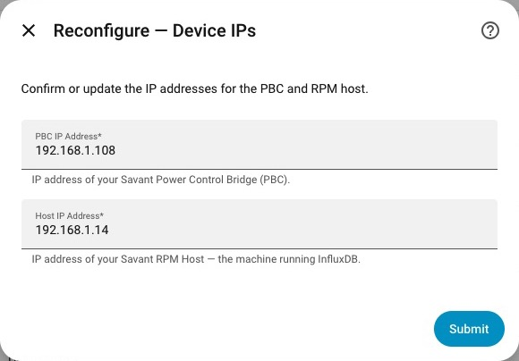

# Connect your system

## Before you start

[Install the integration](../get-started/installation.md) and restart Home Assistant. Have the PBC address ready. For Current mode, also have the Savant Host address and the `RPM` account password. Review [the network requirements](../get-started/requirements.md).

Already using Legacy after a firmware upgrade? Use [migration](../legacy/migration.md) to keep the existing entry.

## 1. Choose the connection mode

Open **Settings → Devices & services → Add integration → Savant Energy**.

- **Auto** is a useful default if you are unsure which feed your system offers. Enter the **PBC IP Address**. A working Legacy feed completes Legacy setup. Otherwise, enter the **Host IP Address** when asked and continue with SSH below.
- **Current** is the direct path for firmware 11.2 or later. Enter both **PBC IP Address** and **Host IP Address**.
- For older firmware, follow the complete [Legacy guide](../legacy/README.md).

*Real Home Assistant Reconfigure capture. Initial setup also offers Auto; Reconfigure offers explicit Legacy and Current choices.*

**Expected result:** Current setup reaches **SSH Bootstrap**. Auto may instead finish as Legacy if it finds the original feed. A failed Legacy probe alone does not establish that your firmware is Current.

*Real Reconfigure capture. The addresses shown belong to the capture installation; use your own PBC and Host addresses.*

## 2. Complete SSH bootstrap

1. Enter the **RPM User Password** for the **Savant Host**, not the PBC.
2. Submit and allow discovery to finish. The integration reads candidate tokens and host metadata, validates access to Savant data, and installs and verifies its refresh key before saving the entry.
3. If multiple plausible organizations are found, select the organization matching your Savant energy data and continue. Most installations do not need this step.

You do not need to locate or paste a token. Old token and manual-organization routes remain compatibility code and are redirected to SSH; their labels in the reference are not extra installation steps.

The password is used for bootstrap and is not saved in the config entry. The validated token and private SSH refresh key are saved there. Home Assistant storage and backups should be protected; this guide does not claim they are encrypted.

**Expected result:** Home Assistant creates the **Savant Energy** entry and starts discovery/polling. A mapping warning can leave an uncertain circuit read-only instead of assigning relay control.

*Real Reconfigure capture, before entering credentials. Initial Current setup uses the same RPM-password bootstrap step.*

## 3. Verify before using controls

Open the integration’s devices and follow [Verify the first readings](verify.md). Confirm supported entities update across more than one configured polling interval.

## When setup stops

| What you see | Next action |
|---|---|
| SSH password authentication failed | Confirm Host and RPM credentials; use [SSH troubleshooting](../troubleshooting-ssh.md) |
| Could not establish SSH connection | Check Host reachability, SSH service, and network rules |
| InfluxDB unreachable or rejected the query | Check Host port 8086 and collect the exact error |
| Multiple organizations | Select the matching Savant data source; do not guess from names alone |
| Missing or uncertain circuits | Read the mapping warning and [telemetry troubleshooting](../troubleshooting/telemetry.md) |

For the full text of source-defined errors, see [error messages](../reference/generated/errors.md). Capture a [focused log](../troubleshooting/logs.md) if the recovery steps do not resolve the problem.
