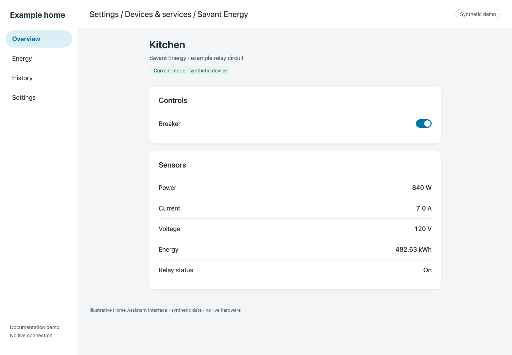

# Check that setup worked

## Before you start

Complete [Current setup](current.md) or [Legacy setup](../legacy/README.md). Verify monitoring before testing relay controls.

## 1. Inspect discovered devices

Open **Settings → Devices & services → Savant Energy**, then open its devices and entities. You should see devices for the circuits discovered on your system and applicable hub/system entities.

*Demo device and readings. Names and available entities vary by system.*

## 2. Check live data

1. Open a supported power sensor and note its state and update history.
2. Wait across at least two polling intervals. The default is five seconds; an unchanged physical load may keep the same value, so use update/report timestamps or logs when investigating freshness.
3. Compare with a known load or the Savant system’s own readings, allowing for different sample timing and rounding.
4. Check that current, voltage, and energy are present only where the source supplies them.

**Expected result:** supported readings continue updating without setup errors. A CT-only load should not acquire a breaker switch merely because it has a power sensor.

## 3. Understand unavailable readings

Missing telemetry is not the same as zero consumption. Some firmware publishes zero-filled placeholder channels; the integration waits for evidence that those channels are active. Historical identity can preserve a circuit’s entity without proving a live measurement.

If several readings remain unavailable, follow [telemetry troubleshooting](../troubleshooting/telemetry.md). Do not delete and recreate the entry as the first diagnostic step.

## 4. Use the data

- Add supported kWh counters to the [Energy dashboard](../usage/energy-dashboard.md).
- Review [relay controls](../usage/controls.md) before switching a load.
- Add the [scenes card](../usage/scenes.md).

Demo images illustrate the interface; they do not establish live hardware verification. Maintainers doing a telemetry release should also follow [live diagnostics](../live-diagnostics.md).
