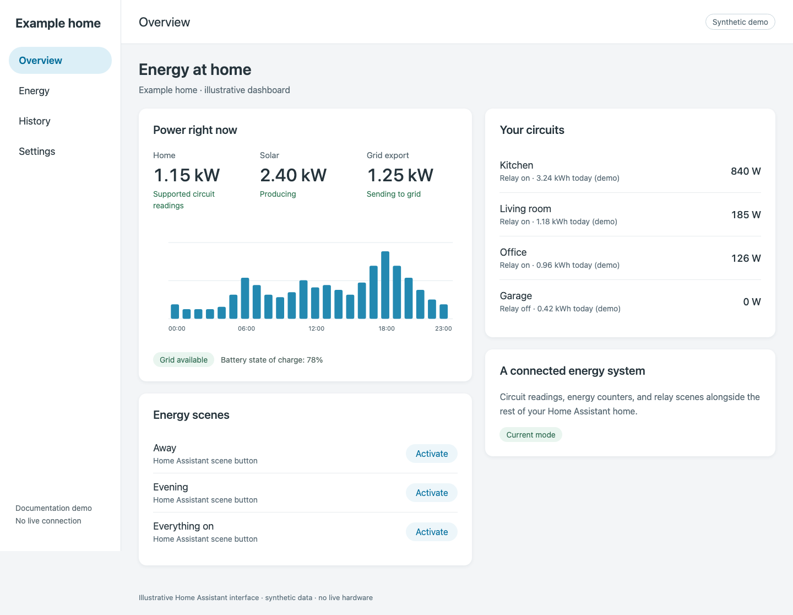

# Your energy system, in Home Assistant

The community **Savant Energy** integration connects Home Assistant to supported Savant energy equipment on your local network. It creates devices and entities you can use in dashboards and automations.

*Illustrative dashboard. All names, values, and devices in documentation images are synthetic.*

## Monitoring and control are separate

A circuit can provide measurements without having a controllable relay. A relay can have a known identity without its firmware publishing power readings. The integration does not invent missing measurements: an unavailable value is different from a confirmed zero.

Current mode can expose circuit power and hardware energy counters, CT loads, and system channels such as grid, solar, and battery. Which entities are useful depends on your hardware and the data your firmware actually publishes.

## Two connection paths

| Mode | Data and control | Setup |
|---|---|---|
| Current | InfluxDB telemetry, host identity inventory, SEM relay interfaces | PBC address, Host address, one-time RPM password |
| Legacy | Original PBC snapshot feed and DMX/OLA control | PBC address |
| Auto | Probes the Legacy feed, then offers Current setup if needed | Start with the PBC address |

Firmware 11.2 introduced the Current architecture. Auto detects the feed rather than proving a firmware version, so a blocked Legacy endpoint can also lead to the Current prompt.

## Start with a working connection

1. Check [requirements](requirements.md) and identify your PBC and Host.
2. [Install the integration](installation.md).
3. Follow [Auto/Current setup](../connect/current.md), or the complete [Legacy guide](../legacy/README.md).
4. [Verify readings](../connect/verify.md) before building dashboards or automations.

This is an independent community project and is not affiliated with, endorsed by, or supported by Savant.
