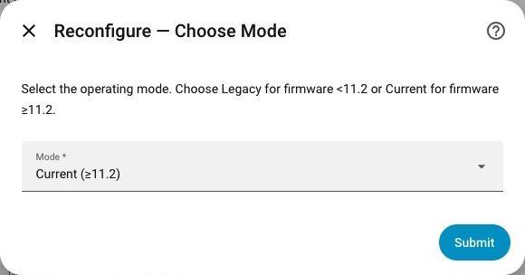
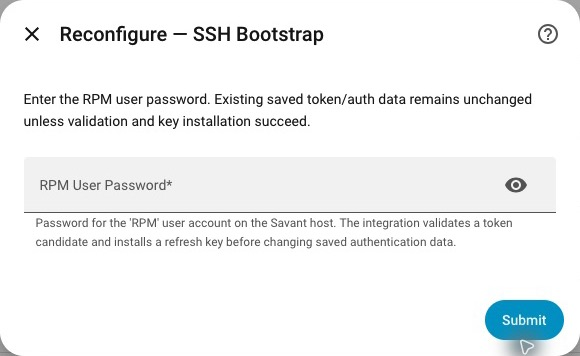

# Move an existing entry to Current mode

## Before you start

Confirm Savant firmware is now 11.2 or later, back up Home Assistant, and record the entity IDs used by important automations and Energy dashboard selections. Have the PBC address, Savant Host address, and RPM password ready.

Keep the existing integration entry. Removing it and starting again is not the intended migration path.

## Reconfigure

1. Open **Settings → Devices & services → Savant Energy**.
2. Open the existing entry’s **three-dot menu → Reconfigure**.
3. Choose **Current**. Reconfigure offers explicit Legacy/Current selection; initial setup’s Auto path is separate.
4. Confirm both **PBC IP Address** and **Host IP Address**.
5. Enter the **RPM User Password** and complete validation and SSH key installation.
6. Select an Influx organization if prompted, then review any circuit-map warnings.
7. Follow [verification](../connect/verify.md) and check your automations and Energy dashboard selections.

**Expected result:** the same entry uses Current mode and discovers applicable Current-only channels. Failed validation or key installation keeps saved authentication state rather than overwriting it with an unverified candidate.

## What can change

The integration uses stable host UUID and SEM/BLE identity data to preserve mapped device/entity continuity. Names alone are not authoritative identity. A successful mapping can preserve history and existing automation references; this is not a guarantee for every historical identity scheme or incomplete inventory.

- Newly discovered CT and system channels can add entities.
- Obsolete DMX entities and confirmed stale entities may be cleaned up.
- Partial inventory must not trigger removal of stored identities.
- Preserved measurement entities can remain unavailable without fresh source data.
- Uncertain relay mappings are kept read-only and reported rather than assigned an unsafe control target.

Check the actual result before relying on migration. If identities or telemetry differ unexpectedly, collect [logs](../troubleshooting/logs.md) and [diagnostic evidence](../live-diagnostics.md).

## Recover from a problem

Use Reconfigure to correct addresses/authentication. If a release regression requires rollback, restore a known release through your installation method and restart; use your Home Assistant backup when configuration rollback is needed. Switching back to Legacy only works when the source still offers the Legacy feed.
