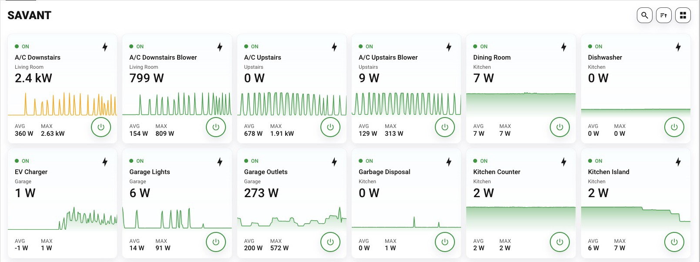
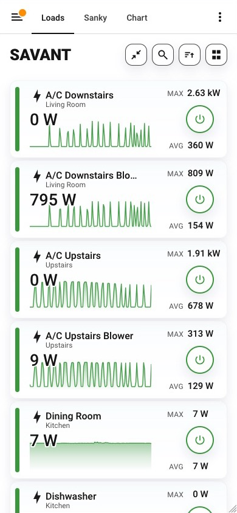
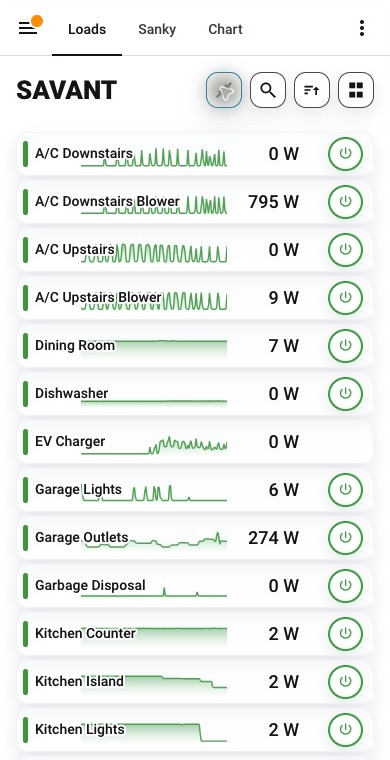

# Put your circuits on a dashboard

The integration includes the [Savant Energy Card](https://github.com/bballdavis/Savant-Card): circuit tiles, history graphs, relay controls, compact mobile views, and saved-scene editing. A tested build is shipped with the integration; a separate HACS Dashboard installation is optional.

The screenshots below show the actual card running in Home Assistant. Readings vary with equipment and capture time.



## Add the included card

**Before you start:** install this integration version, restart Home Assistant, [verify its readings](../connect/verify.md), and leave **Disable Scene Support** off in [options](options.md).

1. Refresh the Home Assistant browser after restart.
2. Edit a dashboard, choose **Add card**, and select **Savant Energy Card**.
3. Use the graphical editor to choose display and control settings. For a minimal manual card:

   ```yaml
   type: custom:savant-energy-breaker-board-card
   ```

4. Save the card and check the discovered circuits against your integration’s entities.

**Expected result:** the card discovers related entities and displays available readings. Missing registry relationships may require [manual mappings](https://github.com/bballdavis/Savant-Card/blob/main/docs/CONFIGURATION.md). For a missing card, see [frontend troubleshooting](../troubleshooting/scenes-card.md).

The integration loads `/local/savant_energy/Savant-Card.js` with a version query for browser caching. Do not add another copy to Dashboard resources. A Home Assistant **panel view** gives the board the available width; sections and masonry layouts also work.

## Upgrade from an existing card

### Previous bundled scenes card

The old scenes-only implementation has been replaced. Existing YAML using `custom:savant-energy-scenes-card` loads a compatibility alias for the new board. The old `show_header: false` option maps to hiding its title; other old layout details are not preserved. You can change the type to `custom:savant-energy-breaker-board-card` and use the new editor when ready. Saved scenes remain backend data.

Remove any manually registered old scenes-card URL, then restart Home Assistant and refresh the browser so a cached copy of the old implementation cannot win registration. The integration automatically loads the replacement and its alias.

### Separate Savant-Card HACS installation

The integration detects these existing Dashboard resources and leaves that copy in charge to avoid duplicate custom elements:

- `/hacsfiles/Savant-Card/Savant-Card.js`
- `/local/community/Savant-Card/Savant-Card.js`
- `/local/Savant-Card.js`

To move to the included build:

1. Remove the standalone card’s Dashboard resource. If HACS manages it, uninstall that **Dashboard** repository so it does not re-add the resource. Keep the Savant Energy **Integration** installed.
2. Remove any other manually registered copies of the board or old scenes card.
3. Reload Savant Energy or restart Home Assistant, then refresh all open Home Assistant browsers.
4. Confirm the card still displays your entities and scenes.

**Expected result:** the bundled build owns the card; no separate frontend download is needed. Keeping the standalone resource is supported, but it follows that repository’s installed version rather than the integration’s pin. Custom resource paths must be removed manually before switching.

## Desktop and mobile layouts

Wide cards display tiles with current wattage, AVG/MAX values, and optional history graphs. Narrow cards switch to stacked rows. The mobile toolbar’s compact control switches between standard and ultra-compact rows.

### Standard mobile



### Ultra-compact mobile



These are real captures at a narrow viewport. Compact mode reduces row detail without changing relay state. The selected mobile view is remembered in that browser.

## Find a load and inspect it

- **Search** filters circuits.
- **Sort** offers circuit number, name, current power, highest usage, and manual ordering. Manual ordering is a placeholder in the companion’s documented v1 surface; use the supported automatic choices.
- Tap a tile for Home Assistant’s more-info view.
- The circular relay control uses configured hold/confirmation behavior. Avoid holding the power control when you only want readings.

Open **Scenes** to inspect saved relay states. See [Scenes and editors](scenes.md) before saving or activating a scene.

For frontend issues, use [Savant-Card](https://github.com/bballdavis/Savant-Card). Backend connection, telemetry, and identity issues belong to this integration. Maintainers can review the [pinned build and update process](../development/companion-build.md).
