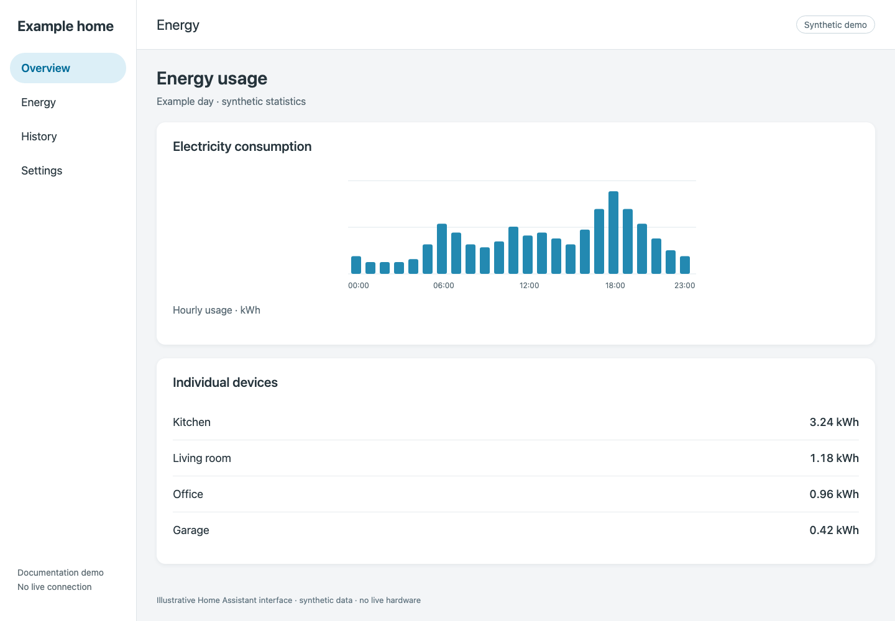

# Add energy monitoring

## Before you start

[Verify your first readings](../connect/verify.md). Use an available cumulative **energy** sensor measured in kWh; a power sensor in W is a different measurement. Current mode reads supported SEM hardware counters rather than estimating energy from power.

## Add an individual load

1. Open Home Assistant’s **Settings → Dashboards → Energy** configuration, or the Energy dashboard’s configuration action for your version.
2. Under **Individual devices**, add the circuit’s eligible kWh energy sensor.
3. Save and allow Home Assistant time to collect statistics. Energy charts are not expected to populate immediately after installation.

*Demo Energy view. Chart values and device totals are synthetic.*

**Expected result:** the supported counter appears as an individual device and begins contributing energy statistics. See [Home Assistant’s Energy documentation](https://www.home-assistant.io/docs/energy/) for its configuration and statistics requirements.

## Avoid counting a load twice

For a multi-leg CT, use either the aggregate or the appropriate legs for your intended calculation. Do not add the same physical usage multiple times. A per-load counter belongs under individual devices; whole-home grid, solar, and battery sources have separate Energy dashboard requirements. A system power sensor is not automatically a suitable cumulative source for those sections.

## If a sensor is missing

Confirm it is an energy sensor with a supported non-placeholder source value. Inspect its unit, device class, state class, and availability in Home Assistant. Wait for statistics collection, then check [telemetry troubleshooting](../troubleshooting/telemetry.md). Do not replace unavailable readings with zero to force a chart to appear.
