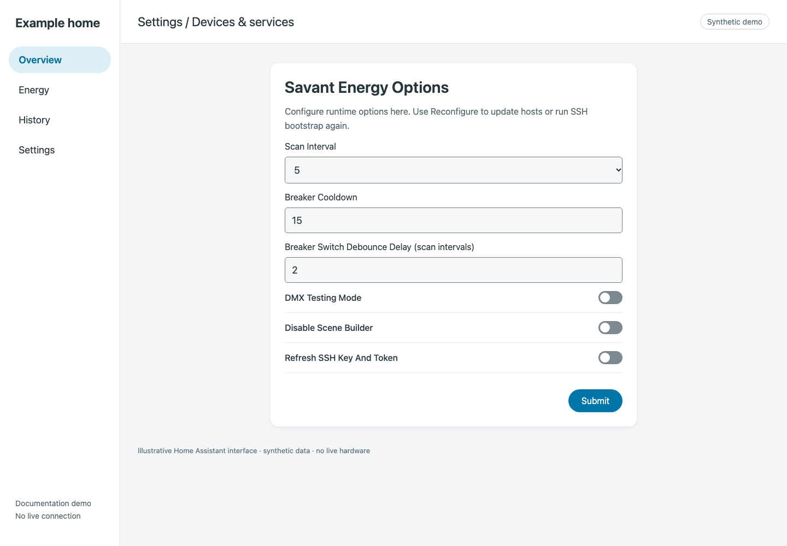

# Change runtime options

Open **Settings → Devices & services → Savant Energy → Configure** (the options action may have a different label in your Home Assistant version).

*Demo form. Values shown are the source defaults.*

| Setting | How to use it |
|---|---|
| Scan Interval | Choose 5, 10, 15, or 30 seconds. More frequent polling does not make the source publish data faster. |
| Breaker Cooldown | Minimum interval between relay toggles; default 15 seconds. |
| Breaker Switch Debounce Delay | Confirmation allowance in scan intervals; default 2. The form accepts 1–10. |
| DMX Testing Mode | Legacy diagnostic mode: log DMX commands without sending them. Leave off for normal operation. |
| Disable Scene Builder | Turn off the integration’s scene-builder setup if you do not use it. |
| Refresh SSH Key And Token | Starts the RPM-password flow to provision a new key and retrieve/validate a fresh token. |

See [generated option defaults](../reference/generated/options.md) for the exact labels, keys, and source defaults.

## Change hosts or mode

Use the integration entry’s **three-dot menu → Reconfigure** to change the PBC/Host addresses or switch between Legacy and Current. Runtime options do not replace connection setup. See [migration](../legacy/migration.md) for the complete mode-change procedure.

## Refresh SSH authentication

Select **Refresh SSH Key And Token** and submit, then enter the RPM password when prompted. The flow validates data and verifies the new key. Keep the old entry rather than deleting it. If automatic token recovery is failing, use [SSH troubleshooting](../troubleshooting-ssh.md) and note the exact failure stage.

**Expected result:** saved options take effect through the integration’s update/reload flow. Confirm subsequent polling and relay behavior before relying on a changed timing value.
