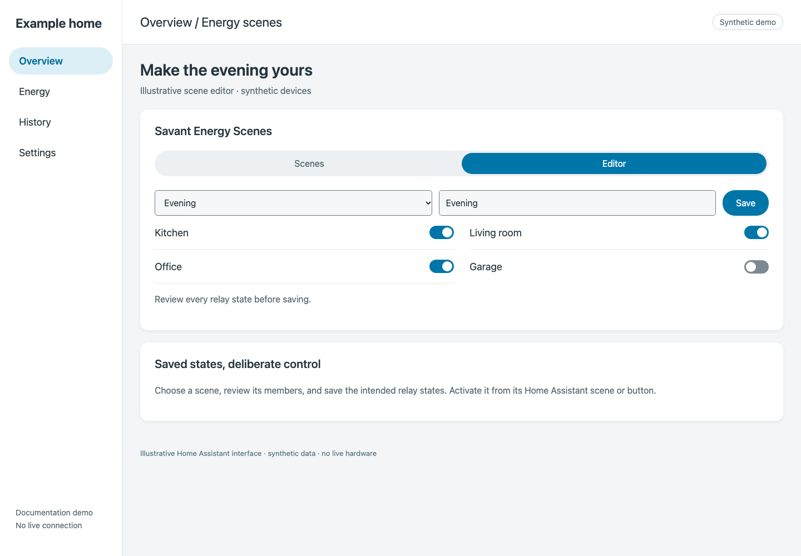

# Build and run energy scenes

The included **Savant Energy Scenes** card manages saved relay states. It runs inside a Home Assistant dashboard; it is not a separate HACS frontend download.

## Before you start

Set up the integration, verify the relays you intend to control, and leave **Disable Scene Builder** off in [options](options.md).

## Add the card

1. Edit a Home Assistant dashboard.
2. Choose **Add card → Manual**.
3. Enter:

   ```yaml
   type: custom:savant-energy-scenes-card
   ```

4. Save the card.



*Demo scenes and relay states; the exact layout can vary with card version.*

**Expected result:** the card loads its scene list. If Home Assistant reports “Custom element doesn’t exist,” follow [card troubleshooting](../troubleshooting/scenes-card.md).

## Create a scene

1. On the **Scenes** tab, enter a name and choose **Create**. Current creation initializes discovered available breaker-like switches to **on**; supplied initial mappings are ignored.
2. Open **Editor**, select the new scene, and review every listed relay. The discovery heuristic includes switches with “breaker” in their entity ID or friendly name.
3. Set the intended states and choose **Save**. Read the saved states back before activation.

To run a scene, use the corresponding Home Assistant scene or button available in your installation; the card’s Scenes list manages stored scenes. Edit and save to change stored states; delete to remove a saved scene.

## For automations and clients

Use the [service reference](../reference/generated/services.md) for Home Assistant scene-management actions and the [REST API guide](../reference/rest-api.md) for authenticated HTTP calls. Creating a scene requires both `name` and `relay_states`.

The current REST breaker-list view defaults newly discovered, unsaved breakers to **on**, while the service handler defaults them to **off**. Review states explicitly; these interfaces are not interchangeable defaults.
