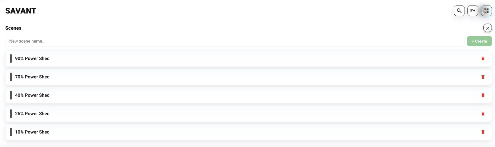
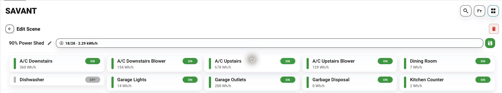

# Manage saved relay states

The included companion breaker board provides the scene editor. It replaces the previous bundled scenes-only interface; existing `custom:savant-energy-scenes-card` YAML uses a compatibility alias for the new board. See [card setup and migration](companion-card.md).

## Inspect a saved scene

**Before you start:** connect the integration, leave **Disable Scene Builder** off, and [add the included card](companion-card.md).

1. Open the card’s **Scenes** toolbar action.
2. Select a saved scene to inspect its members and planned on/off states.
3. Review every member before saving or activating it.

The editor estimates load from available average readings; optional battery-capacity configuration adds drain estimates in supported companion versions.

*Real Home Assistant captures. No relay was toggled, scene activated, or scene saved for these screenshots.*

**Expected result:** you can inspect stored relay states. Editing a stored scene does not prove a physical load changed. Execute a saved scene through the corresponding Home Assistant scene/button, then verify live status. For a missing card or failed request, see [card troubleshooting](../troubleshooting/scenes-card.md).

## Create and edit carefully

1. Enter a name and choose **+ Create**. Current backend creation initializes discovered available breaker-like switches to **on**, ignoring supplied initial mappings.
2. Open the new scene and review every relay. Backend discovery includes switches with “breaker” in their entity ID or friendly name.
3. Set intended states, save, and read them back before activation.

The REST breaker-list view defaults newly discovered unsaved members to **on**, while the service handler defaults them to **off**. Review states explicitly rather than assuming matching defaults.

## For automations and clients

Use the [service reference](../reference/generated/services.md) and [REST API](../reference/rest-api.md) for authenticated calls. Creating a scene requires both `name` and `relay_states`; the REST guide documents the current creation/update limitations.
